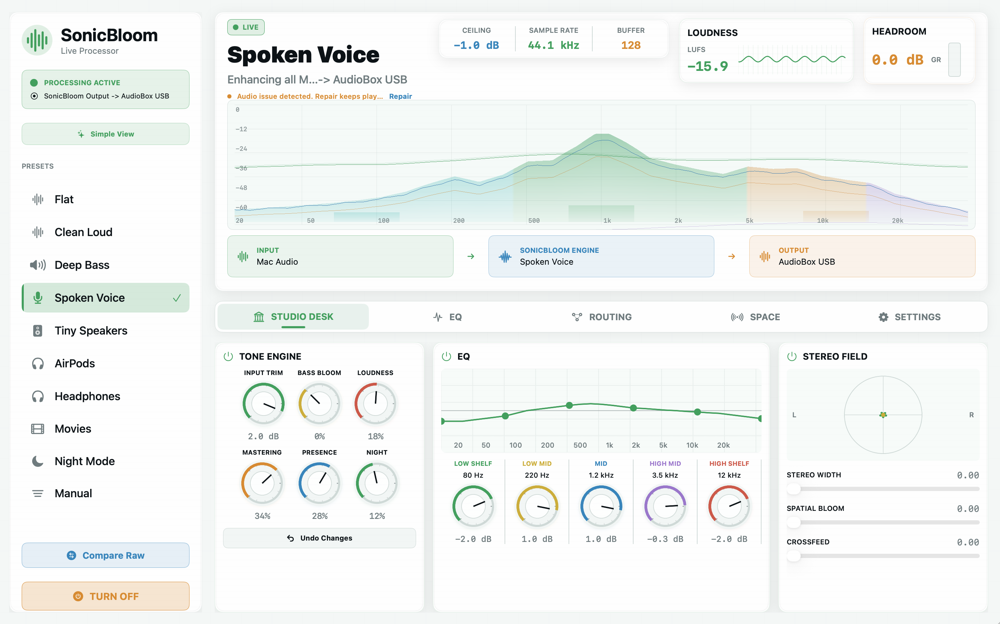

# SonicBloom

<p align="center">
  
</p>

<p align="center">
  <strong>A from-scratch macOS system audio enhancer with a native app, virtual output device, realtime DSP, spatial processing, clipping protection, and open presets.</strong>
</p>

<p align="center">
  
  
  
  
</p>

SonicBloom routes Mac audio through a source-owned virtual output named `SonicBloom Output`, processes it in realtime, then sends it to the physical speakers, headphones, AirPods, or audio interface you choose.

The goal is simple: make system audio louder, clearer, safer, and more spacious without hiding the signal path. No copied code, presets, branding, or assets from commercial audio apps.

## What it does

| Area | Built into SonicBloom |
| --- | --- |
| System audio route | HAL virtual device prototype, route manager, crash recovery helper, quit/off restores physical output |
| Realtime DSP | 31-band EQ, bass bloom, stereo width, crossfeed, loudness, limiter, true-peak style safety, output gain |
| Spatial audio | Synthetic BRIR/HRTF engine plus imported SOFA-style JSON BRIR/HRTF profiles |
| Device tuning | Built-in profiles for MacBook speakers, AirPods, headphones, speakers, and consumer Bluetooth outputs |
| Safety | Clipping monitor, limiter ceiling, headroom meter, loudness-matched raw compare, field-tested output caps |
| UI | Native macOS app, menu bar controls, smooth Metal waveform/spectrum renderer, preset browser, routing, settings |
| Presets | Flat, Clean Loud, Deep Bass, Spoken Voice, Tiny Speakers, AirPods, Headphones, Movies, Night Mode, Manual |
| Extensibility | Open JSON preset format, custom presets, AutoEQ import, BRIR/HRTF import, Audio Unit effect hosting |

## Signal path


## Why it exists

Most Mac audio enhancers are closed boxes. SonicBloom is built as an open, inspectable version of the same idea:

- The virtual output is owned by this repo.
- Presets and imported profiles are plain JSON.
- The DSP engine is C++ with Swift bindings.
- Route repair and diagnostics are visible in the app.
- Safety comes before loudness.

## Highlights

### Studio desk

The main view keeps the important controls in one place: tone, EQ, stereo field, input/output routing, live headroom, loudness, and the actual processing state.

### Clean loudness

SonicBloom boosts perceived loudness with gain staging and limiting instead of raw digital clipping. The limiter ceiling, headroom, protected clip count, and raw compare mode make the tradeoff visible.

### Spatial engine

SonicBloom includes a synthetic HRTF/BRIR path and can use imported BRIR/HRTF JSON profiles for headphone-specific spatial tuning. Binary `.sofa` files should be converted to JSON first.

### Device-aware safety

MacBook speakers and small consumer outputs get conservative bass, spatial, HRTF, and gain caps. Unknown USB/pro audio interfaces are left alone in music mode so studio hardware is not over-managed.

### Recovery-first routing

Turning enhancement off restores the physical output instead of leaving macOS pointed at a silent virtual device. A recovery helper watches for route failures and app crashes.

## Current status

SonicBloom is an active macOS prototype that already builds into a clickable `.app` bundle and includes a bundled `SonicBloomHAL.driver`.

What is ready now:

- Native app shell and menu bar app
- System route model and recovery helper
- HAL driver bundle prototype
- Realtime stereo DSP engine
- Metal waveform/spectrum renderer
- Presets, custom preset import/export, AutoEQ import, BRIR/HRTF JSON import
- Automated tests for DSP, routing, presets, diagnostics, release scripts, and UI contracts

What still needs production credentials:

- Developer ID signing
- Notarized `.pkg`
- Public release hosting
- Wider live-device QA before calling it stable for non-developers

## Build locally

```bash
swift test
Scripts/build_app.sh
open dist/SonicBloom.app
```

The app bundle includes `SonicBloomHAL.driver`. In the app, use **Install Driver** to copy it into:

```text
/Library/Audio/Plug-Ins/HAL/
```

macOS will ask for administrator approval, then Core Audio restarts.

## Package a release

Unsigned local package:

```bash
Scripts/package_release.sh
```

Developer ID installer:

```bash
SONICBLOOM_INSTALLER_IDENTITY="Developer ID Installer: Your Name (TEAMID)" \
Scripts/package_release.sh
```

Signed and notarized app plus installer:

```bash
SONICBLOOM_APP_IDENTITY="Developer ID Application: Your Name (TEAMID)" \
SONICBLOOM_INSTALLER_IDENTITY="Developer ID Installer: Your Name (TEAMID)" \
SONICBLOOM_NOTARY_PROFILE="sonicbloom-notary" \
Scripts/package_release.sh
```

Set `SONICBLOOM_UPDATE_MANIFEST_PUBLIC_KEY_HEX` while building the app to require signed update manifests. Set `SONICBLOOM_UPDATE_MANIFEST_PRIVATE_KEY_HEX` while packaging so the release manifest is signed after the package checksum is known.

Each release also writes:

- `dist/release/SonicBloom-Uninstall.command`
- `dist/release/SonicBloom-update.json`

Upload the update JSON beside the `.pkg` asset so the in-app updater can find new builds.

## QA

Run the automated gate:

```bash
Scripts/qa_gate.sh
```

For long playback checks:

```bash
Scripts/stability_watch.sh
```

Before tagging a build stable, run the live scenarios in [Docs/QA-Matrix.md](Docs/QA-Matrix.md): YouTube, Spotify, Zoom, Bluetooth reconnects, AirPods switching, sleep/wake, output-device changes, and uninstall recovery.

## Support diagnostics

The app can copy a diagnostics report with route, latency, buffer, CPU, preset, sync mode, active spatial profile, and audio-health state. See [Docs/Support.md](Docs/Support.md).

## License

MIT. See [LICENSE](LICENSE).
